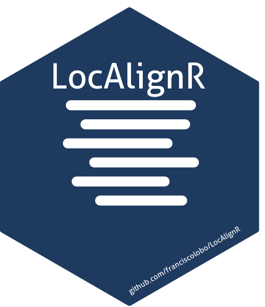

# LocAlignR



**LocAlignR** is a free, open-source, cross-platform R/Shiny application for biological sequence alignment. It provides a graphical interface for searching local sequence databases with BLAST and DIAMOND, managing databases, exploring alignments, and exporting results.

Local searches run on your computer, without sending query sequences to a remote alignment service. Optional remote BLAST searches are also supported.

LocAlignR was inspired by [Shiny_BLAST](https://github.com/ScientistJake/Shiny_BLAST).

## Features

- BLAST+: `blastp`, `blastn`, `blastx`, `tblastn` and `tblastx`.
- DIAMOND: `blastp` and `blastx` against protein databases.
- Paste sequences or upload FASTA files; load existing alignment XML files.
- Configure search parameters and save or reload search strategies.
- Build local BLAST and DIAMOND databases with optional metadata and manage them in the database registry.
- Explore hits in an interactive, filterable table and inspect individual alignments.
- Export interactive HTML reports, Excel workbooks, raw XML, JSON search strategies and YAML job summaries.
- Inspect tool availability and runtime paths in the **Diagnostics** tab.

## Installation

Download platform-specific installers from [GitHub Releases](https://github.com/franciscolobo/LocAlignR/releases). If a platform installer is not yet listed, it has not been published there.

| Platform | Recommended installation |
| --- | --- |
| Windows (x86-64; Windows 10 version 1809 or later / Windows 11) | Windows installer `.exe` |
| macOS (Apple Silicon or Intel) | macOS installer `.zip` |
| Linux | Conda |

Internet access is required for installation and optional reference database downloads. Allow sufficient disk space for the runtime and your sequence databases.

### Windows

1. Download the Windows installer and its checksum from the release page.
2. Run the installer. It reuses a suitable Conda installation or provisions a private Miniforge installation, creates a dedicated environment, and downloads checksum-verified official BLAST and DIAMOND binaries.
3. Optionally select the curated protein database and desktop shortcut.
4. Launch LocAlignR from the Start menu or the desktop shortcut.

Administrator privileges are not required by the installer itself. Institutionally managed computers may impose additional restrictions. Windows installers are currently unsigned; SmartScreen may warn or block execution. Verify the checksum and contact your IT administrator if execution is blocked. Do not disable institutional security controls.

### macOS

Download and extract the macOS installer ZIP appropriate for your Mac. Open **LocAlignR Installer.app** and follow the Terminal prompts. The installer provisions Conda if necessary, installs the runtime and offers optional database provisioning and a launcher in `~/Applications`.

#### macOS security warning

The macOS installer is currently distributed without Apple Developer ID signing and notarization. Consequently, macOS may display the following warning when opening the downloaded installer:

- Apple could not verify “LocAlignR Installer” is free of malware that may harm your Mac or compromise your privacy.

After verifying the downloaded archive against the published SHA-256 checksum:

1. Click **Done**.
2. Open **System Settings → Privacy & Security**.
3. Scroll down to the **Security** section.
4. Click **Open Anyway** next to the message concerning LocAlignR Installer.
5. Confirm your decision and proceed with the installation.

This authorizes the specific installer without disabling macOS security protections globally.

On institutionally managed computers, this option may be unavailable. Contact your IT administrator if installation is restricted.

For additional information, consult [Apple's official documentation](https://support.apple.com/en-us/102445).

### Linux / manual Conda installation on macOS

With Conda or Miniforge available, run:

```bash
conda create -n localignr -y --override-channels --strict-channel-priority \
  -c conda-forge -c bioconda -c franciscolobo \
  r-localignr=0.2.1 r-jsonlite
conda activate localignr
R -e 'LocAlignR::run_app()'
```

On Windows, use the graphical installer rather than the standard `r-localignr` Conda package. The separate `r-localignr-windows` package is an installer component and does not provision the alignment engines by itself.

See [installation and troubleshooting](docs/installation.md) for further details.

## Quick start

1. Launch LocAlignR and check the **Diagnostics** tab.
2. If you have not installed a reference database, open **Build local sequence database**, select a FASTA file, choose a database name, molecule type, backend and output directory, then build the database. DIAMOND accepts protein databases only.
3. In the alignment panel, paste a query sequence or upload a FASTA file. Choose the aligner, program and a compatible local database.
4. Set the e-value and any advanced parameters, then run the search.
5. Explore the results table and select a hit to inspect its alignment. Use the Downloads section to save results or the search configuration.

Example FASTA files are available in [docs/test-data](docs/test-data/).

## Reference databases

LocAlignR does not bundle large sequence databases. You can build your own from FASTA files or optionally download the UniProtKB/Swiss-Prot dataset offered by the desktop installers. The current installer manifest identifies the 2026-06-05 dataset hosted on Zenodo, with associated sequence metadata. The installers verify the archive checksum, format the database locally for BLAST and DIAMOND and register it for use in LocAlignR.

The **Databases** tab shows registered databases and their on-disk status. Database registrations are maintained separately from the application runtime.

## Results and exports

| Format | Contents |
| --- | --- |
| HTML report | Interactive results table with metadata and alignment details |
| Excel (`.xlsx`) | Hit-level results, metadata and alignment text |
| XML | Raw alignment engine output |
| JSON search strategy | Search settings for repeating or sharing a search, not hit-level results |
| YAML job report | Search configuration and a brief summary, not the full hit table |

## Privacy and offline use

Local BLAST and DIAMOND searches can run offline after the required software and databases are installed. The special BLAST database selections `nr` and `nt` initiate remote BLAST searches and transmit query sequences to NCBI. Do not select them for confidential data. Installation and optional reference database downloads require network access. Diagnostic logs can contain local paths and environment information; review logs before sharing them.

## Citation, license and support

Please cite LocAlignR using [CITATION.cff](CITATION.cff) or `citation("LocAlignR")` in R. The project is distributed under the [MIT License](LICENSE); external alignment engines and their dependencies retain their own licenses.

Report problems or request features through [GitHub Issues](https://github.com/franciscolobo/LocAlignR/issues). See [CONTRIBUTING.md](CONTRIBUTING.md) for contribution guidelines.

Developer documentation: [build automation](docs/BUILD-AUTOMATION.md) and [Windows installer build instructions](installers/windows/BUILD.md).
